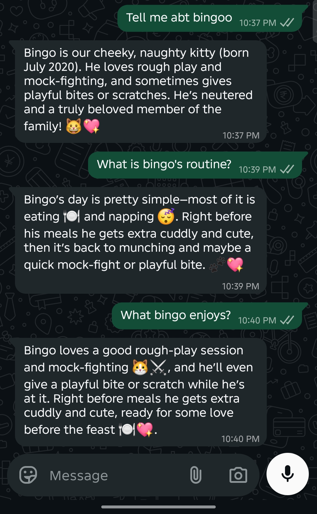

# WhatsApp AI Bot

A personal WhatsApp chatbot built with **Baileys**, **LangChain** and **Groq**. It decides what each message needs, remembers who you are, follows a conversation across topics, and answers questions about my cat Bingo using only facts from a knowledge base.

## What it does

- **AI routing:** a small, fast model reads each message in context and picks the right handler, so follow-ups like "what does he eat?" just work.
- **Grounded answers (RAG):** questions about Bingo are answered from `kb.txt` using local embeddings. If the answer isn't there, the bot says it isn't sure.
- **Personal memory:** names, cities and hobbies are extracted into a validated profile and used naturally in later replies.
- **Shared conversation history:** every reply goes into one per-person history, trimmed so long chats stay fast.
- **Private by default:** the bot only answers you, and ignores groups, channels, and every other contact.

## Example conversation

Live on WhatsApp:



A longer conversation, showing memory and topic changes. This is real output from the bot's message handler:

```text
You: My name is Fati and I live in Lahore
Bot: Hey Fati! Nice to meet you 😊 Lahore is such a vibrant city—what's your favorite spot there?

You: How old is Bingo?
Bot: Bingo is 6 years old now 🎉🐾

You: what does he eat?
Bot: He's a boneless-chicken fan— that's his favorite treat! 🍗😸

You: does he have whiskers?
Bot: I'm not sure about that, sorry! 🐱✨

You: no more bingo pls, also I like camping and reading books
Bot: Got it, no more Bingo! 🌟 So, what's your favorite camping spot around Lahore? And any book you're currently lost in? 📚🏕️

You: Crime and action like
Bot: Nice vibe! 🎬🔪 Got any favorite crime-thrillers? If you're looking for a new one, try "The Girl with the Dragon Tattoo" for a dark twist, or "Gone Girl" for some mind-games. For action, "The Bourne Identity" never hurts. What's the last book that kept you up all night? 📖✨

You: what do you know about me?
Bot: Here's what I know about you:
  Name: Fati
  City: Lahore
  Hobbies: camping, reading books
```

## How a message flows

```text
Incoming WhatsApp message
    │
    ▼
Live message, in your self-chat or from an allowed number?
    │  no → ignored
    ▼ yes
Two jobs run side by side
    ├── Route the message (recall, bingo or chat)
    └── Extract any personal facts and save them
    │
    ├── recall → show the saved profile, with no model call
    ├── bingo  → retrieve matching facts from kb.txt, answer from those only
    └── chat   → general reply, using history and the saved profile
```

## Project structure

| File | Role |
|---|---|
| `index.js` | WhatsApp connection, reconnecting, per-person message queue |
| `access.js` | Decides who the bot may answer |
| `router.js` | AI classifier that picks the handler for each message |
| `chat.js` | General chat chain and per-person conversation history |
| `rag.js` | Embeds `kb.txt`, retrieves relevant facts, writes grounded answers |
| `memory.js` | Structured fact extraction with a Zod schema, profile storage |
| `models.js` | Groq model names, in one place |
| `kb.txt` | One fact per line about Bingo |

## Setup

You need Node.js 20 or newer and a free API key from [console.groq.com](https://console.groq.com).

```bash
npm install
cp .env.example .env     # then add your GROQ_API_KEY
npm start
```

Scan the QR code in your terminal from WhatsApp under **Linked Devices**. On the first start the embedding model (`Xenova/all-MiniLM-L6-v2`) downloads once, so it takes a little longer.

## Who the bot answers

By default it replies only in your own **Message yourself** chat, on the account you linked. To let another phone talk to it, add the number with its country code in `.env`:

```bash
ALLOWED_NUMBERS=923001234567
```

Blocked senders are logged to the terminal as `[blocked] message from <number>`.

## Good to know

- Chat history and profiles are held in memory, so they reset when the bot restarts. Your WhatsApp login is saved in `auth_info_baileys/` and does survive.
- Baileys is an unofficial WhatsApp client, and WhatsApp can restrict accounts that use one. A spare number is the safest choice.
- If you log out from your phone, delete `auth_info_baileys/` and scan the QR code again.
